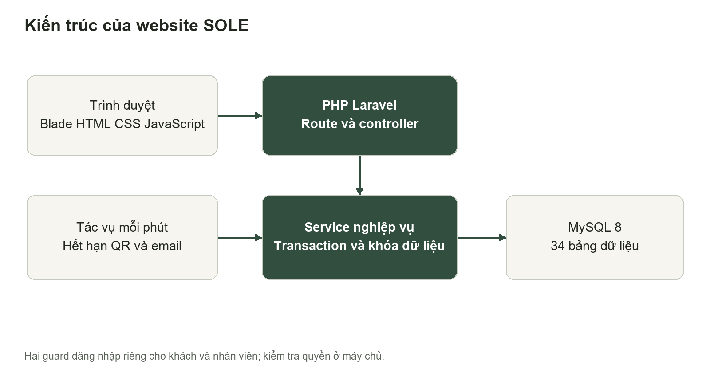
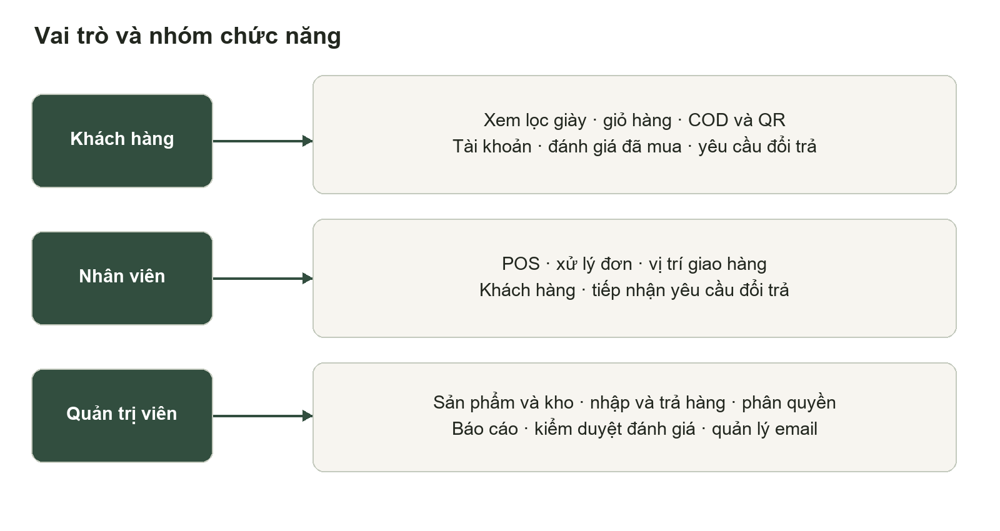
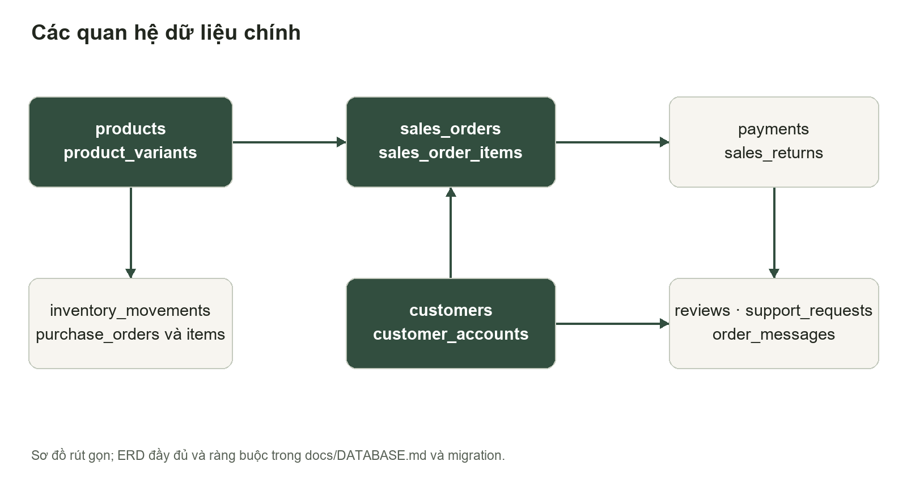
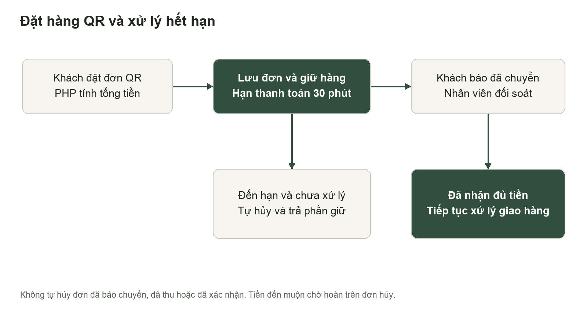
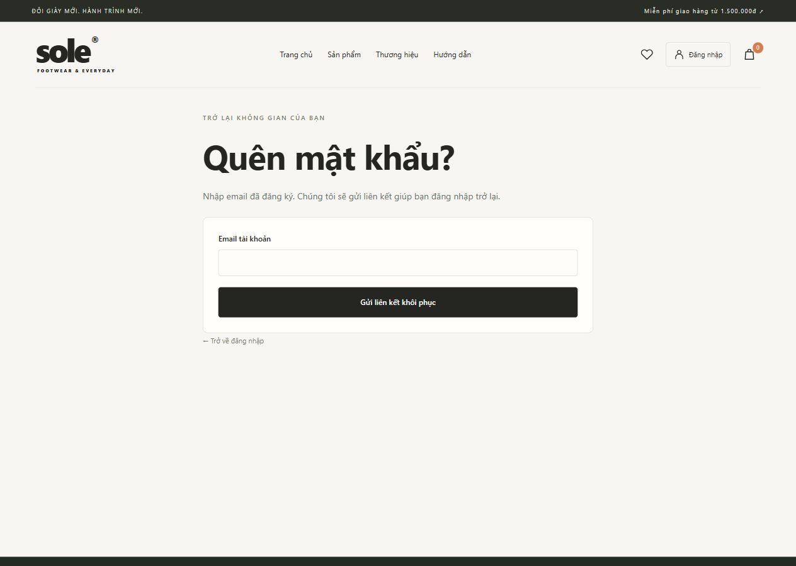
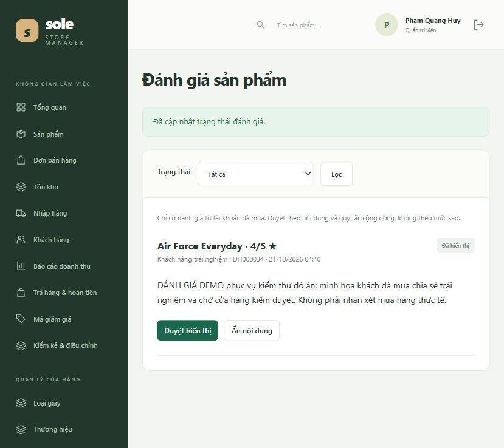
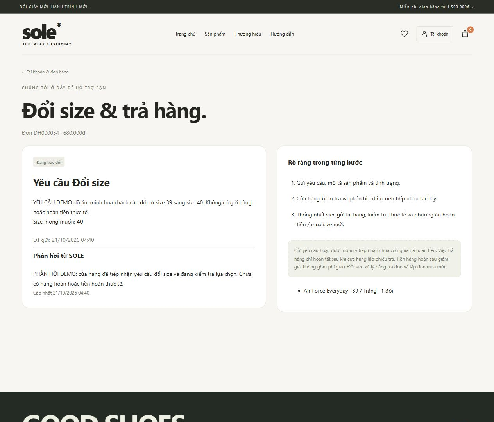

# Báo cáo kỹ thuật website quản lý cửa hàng bán giày

Nhóm 6 — Phạm Quang Huy và Đào Ngọc Tú. Cập nhật 21/10/2026.

## Mở đầu và phạm vi

Nhóm xây dựng SOLE để quản lý một cửa hàng giày và một kho, đồng thời cho khách mua trực tuyến. Hệ thống quản lý theo SKU gồm mẫu giày, size và màu; mỗi giao dịch nhập, bán, điều chỉnh và trả hàng có chứng từ để đối chiếu.

Phần mềm hiện chạy bằng PHP Laravel, JavaScript và MySQL. Các chức năng mua hàng, giữ kho, thanh toán và giao hàng đã được triển khai cùng kiểm thử tự động. Dữ liệu, ảnh minh họa và các giao dịch DEMO phục vụ đồ án; không đại diện hoạt động kinh doanh thực tế.

| Vai trò | Phạm vi |
| Khách hàng | Xem và lọc giày, giỏ hàng, đặt COD/QR, tài khoản, đánh giá đã mua, yêu cầu đổi/trả |
| Nhân viên | POS, xử lý đơn và vận chuyển, tra cứu tồn, khách hàng, phản hồi yêu cầu |
| Quản trị viên | Danh mục, nhập/điều chỉnh kho, hoàn tiền, phân quyền, báo cáo và kiểm duyệt |
Báo cáo mô tả bản triển khai ngày 21/10/2026, đối chiếu đề cương hiện có của môn Đồ án chuyên ngành Công nghệ phần mềm. Thông tin hành chính, mã sinh viên và nhận xét giảng viên cần được nhóm bổ sung theo hồ sơ chính thức; báo cáo không tự điền điểm hoặc xác nhận.

## Chương 1 Cơ sở công nghệ

Laravel tổ chức ứng dụng theo MVC. Route và middleware xác định điểm truy cập, phiên đăng nhập và quyền; controller xác thực dữ liệu; service tập trung các thay đổi kho, đơn và tiền trong transaction; Eloquent ánh xạ dữ liệu quan hệ. Blade tạo HTML, JavaScript tăng tương tác trên trình duyệt.

| Thành phần | Bản triển khai |
| Máy chủ | PHP 8.3.35 và Laravel 12 |
| Trình duyệt | Blade, HTML, CSS, JavaScript thuần |
| Cơ sở dữ liệu | MySQL 8.0.46 tại 127.0.0.1:3309 |
| Kiểm thử | PHPUnit trên SQLite và MySQL riêng |
MySQL là database của website. SQLite chỉ dùng trong một số bài kiểm thử và giữ bản nguồn trước khi nâng cấp. MySQL Workbench là công cụ kết nối để xem và quản trị dữ liệu.

## Chương 2 Yêu cầu và phân quyền

Khách và nhân viên dùng hai guard riêng. Đăng nhập khách không cấp quyền quản trị. Nhân viên không sửa danh mục, không điều chỉnh kho, không duyệt đánh giá hoặc xuất báo cáo. Admin có các quyền này nhưng không tự khóa tài khoản đang dùng.

Mọi giá bán, giảm giá, phí giao, quyền và lượng hàng đều được kiểm tra tại server. Hệ thống phải tránh bán âm, trừ kho hai lần và ghi nhận tiền hai lần khi người dùng gửi lại thao tác. Giao diện có nhãn biểu mẫu, phản hồi lỗi và bố cục dùng được trên điện thoại.

## Thiết kế cơ sở dữ liệu

Database sole_store có 34 bảng: 25 bảng nghiệp vụ và 9 bảng hạ tầng. Nhóm bảng chính gồm tài khoản, danh mục, sản phẩm/biến thể/ảnh, khách/nhà cung cấp, nhập/bán, thanh toán, sổ kho, ưu đãi, trả hàng, đánh giá, yêu cầu hỗ trợ và email đơn hàng.

SKU và tổ hợp sản phẩm–size–màu là duy nhất. Mỗi đơn một khoản thu; mã giao dịch ngân hàng không dùng cho hai đơn. Một tài khoản đánh giá mỗi sản phẩm một lần; mỗi đơn một yêu cầu hỗ trợ và một email xác nhận theo loại. Khóa ngoại bảo vệ lịch sử chứng từ.

Tiền lưu DECIMAL(15,0), xử lý bằng số nguyên VND. Chi tiết đơn lưu tên, SKU, size/màu và giá tại lúc bán. Sửa sản phẩm không làm đổi đơn cũ. Token khôi phục khách được băm và lưu riêng token nhân viên. Chi tiết cột và ERD đầy đủ nằm trong docs/DATABASE.md và migration.

## Quy trình đặt hàng và thanh toán

Khách chọn đúng biến thể, nhập thông tin nhận, áp ưu đãi và chọn COD hoặc QR. PHP tính tổng, lưu đơn cùng snapshot. QR chỉ bật khi đã có tài khoản ngân hàng hợp lệ. Nút báo chuyển khoản không tự tạo payment; nhân viên đối chiếu sao kê, số tiền và mã giao dịch trước khi xác nhận.

Đơn QR mới chưa báo chuyển, chưa thu và chưa được xác nhận có hạn mặc định 30 phút. Scheduler chạy mỗi phút; thao tác xem đơn và báo chuyển cũng kiểm tra hạn. Hủy giải phóng phần giữ kho và lượt ưu đãi một lần. Nếu tiền đến muộn, giữ đơn hủy và ghi nhận chờ hoàn toàn bộ; không khôi phục đơn hoặc hàng giữ.

## Quản lý kho giao hàng và tài chính

Tồn sổ sách gồm hàng chưa xuất bán, kể cả hàng giữ chỗ/đang giao. Số có thể bán bằng tồn sổ sách trừ giữ chỗ. COD giữ khi xác nhận; QR giữ khi tạo. Chỉ hoàn tất mới xuất sổ sách và giải phóng phần giữ, kể cả đã thu QR trước.

| Thời điểm | Tồn sổ sách | Giữ chỗ | Có thể bán |
| Trước đơn | 10 | 0 | 10 |
| Giữ 2 đôi | 10 | 2 | 8 |
| Hoàn tất đơn | 8 | 0 | 8 |
Giao hàng chuyển tuần tự: chờ xác nhận, xác nhận, chuẩn bị, đang giao, đã giao. QR phải thu đủ trước khi bàn giao. Giao thất bại có thể thử lại hoặc nhận hàng hoàn về rồi hủy; không trả kho giữ khi hàng vẫn đang đi.

Tổng thanh toán = tiền hàng − giảm giá + phí giao. Phí mặc định 30.000đ, miễn từ 1.500.000đ tiền hàng trước giảm. Doanh thu tính theo đơn hoàn tất và trừ phiếu trả. Dòng tiền tính theo ngày thu/hoàn; tiền trả trước chưa phải doanh thu. Báo cáo chưa tính lợi nhuận vì chưa có phương pháp giá vốn.

Trả đơn hoàn tất hoàn tiền hàng sau giảm, không hoàn phí giao. Hủy đơn trả trước hoàn toàn bộ số đã thu, gồm phí giao. Cả hai là xác nhận giao dịch thực tế do cửa hàng thực hiện, không tự chuyển tiền ngân hàng.

## Bảo vệ tài khoản và khôi phục mật khẩu

Luồng quên mật khẩu trả cùng thông báo cho email có và không có tài khoản. Liên kết tạo từ APP_URL, dùng token ngẫu nhiên được băm, hết hạn 60 phút và chỉ sử dụng một lần. Hàng token được khóa khi đặt lại mật khẩu để tránh hai yêu cầu dùng đồng thời.

Đặt lại hoặc đổi mật khẩu tăng auth_version. Middleware kiểm tra phiên trên toàn website, bao gồm checkout; phiên cũ mất hiệu lực ở yêu cầu tiếp theo. Hệ thống còn có CSRF, giới hạn đăng nhập/reset/chat, validation server, escape nội dung và tách dữ liệu theo chủ tài khoản. Thư reset hiện dùng mail log nội bộ, cần SMTP để gửi thật.

## Đánh giá sản phẩm và nội dung danh mục

Chỉ tài khoản có đơn hoàn tất chứa sản phẩm mới gửi được đánh giá từ 1 đến 5 sao. Nội dung mới/chỉnh sửa ở trạng thái chờ duyệt; chỉ admin duyệt hoặc ẩn. Điểm trung bình chỉ dùng đánh giá đã duyệt. Tên hiển thị rút gọn và nội dung được escape; không công khai email hay địa chỉ.

Admin có thể thêm chất liệu đã xác nhận, form, cách chăm sóc và ghi chú size cho từng mẫu. Thư viện tối đa 8 ảnh JPG/PNG/WebP, mỗi ảnh không quá 4 MB, cho phép đổi bìa và xóa từng ảnh. Ảnh thật phải đúng mẫu, màu và có quyền sử dụng. Chưa có ảnh thật thì giữ nhãn minh họa, không tạo thông số hoặc lời đánh giá giả.

## Yêu cầu đổi size và trả hàng

Khách gửi yêu cầu từ đơn của mình trong trang tài khoản. Yêu cầu gồm lý do và size mong muốn nếu đổi; một yêu cầu trên mỗi đơn. Cửa hàng tiếp nhận, trao đổi, đồng ý hoặc từ chối. Phản hồi gần nhất được hiển thị cho đúng khách sở hữu đơn.

Gửi yêu cầu hoặc đồng ý tiếp nhận chưa thay đổi kho/tiền. Admin phải nhận hàng, kiểm tra và lập phiếu trả trước khi đóng yêu cầu. Bản hiện tại trả toàn bộ đơn, đổi size bằng trả đơn và lập đơn mua mới; chưa trả từng dòng hoặc tự bù chênh lệch. Ảnh chụp trang này là dữ liệu DEMO ghi rõ trong nội dung.

## Chương 3 Cài đặt và tác vụ nền

Chạy start.ps1 trong shoe-store để khởi động MySQL local nếu cần, cập nhật migration an toàn, bật scheduler và website. Trên máy hiện tại, database sole_store ở cổng 3309; sole_store_test được dành cho test, không trộn với database website.

| Việc cần làm | Lệnh hoặc cấu hình |
| Khởi động | PowerShell: .\start.ps1 |
| Chỉ tác vụ nền | .\start-worker.ps1 hoặc php artisan schedule:work |
| Kiểm tra lịch | php artisan schedule:list |
| Áp dụng cấu trúc | php artisan migrate --force |
| Thử hết hạn QR | php artisan store:expire-qr |
| Thử hàng đợi email | php artisan store:send-order-mail |
Email xác nhận được ghi vào outbox trong transaction đặt hàng, sau đó tác vụ gửi và thử lại tối đa ba lần nếu lỗi. Chế độ log/array tạo bản xem thử, không báo gửi thật. SMTP cần cấu hình từ nhà cung cấp; khởi động lại worker sau khi sửa. Không đặt mật khẩu, API key hoặc log trong public.

Sao lưu SQL MySQL, thư mục ảnh và .env riêng. Trên hosting dùng web root public, HTTPS, production, tắt debug và mật khẩu thật. Không dùng artisan serve làm web server công khai. Cấu hình ngân hàng và AI do chủ đồ án tự điền theo lựa chọn đã thống nhất.

## Kết quả kiểm thử

Bộ kiểm thử đạt 81 ca với 779 assertions trên SQLite và MySQL 8.0.46. Bài kiểm thử MySQL chỉ dựng dữ liệu trong sole_store_test. SQL schema/demo được xuất từ migration và kiểm tra import riêng. Dữ liệu website được đối chiếu tồn, giữ chỗ, đơn và tiền.

| Nhóm kiểm tra | Điều kiện được xác minh |
| Đơn và kho | Không bán vượt tồn, giữ đúng SKU, hoàn tất/hủy không ghi lặp |
| Thanh toán | Đúng tổng, mã ngân hàng duy nhất, báo chuyển chưa thu, hoàn/tiền đến muộn |
| Hết hạn QR | Trả giữ/lượt mã một lần; không hủy đơn đã báo, thu, xác nhận hoặc đơn cũ |
| Tài khoản | Token riêng, băm, hết hạn, dùng một lần và thu hồi phiên cũ |
| Khách hàng | Đánh giá sau mua, duyệt/ẩn, escape; yêu cầu riêng tư và chống gửi lặp |
| Email và ảnh | Mail lỗi không mất đơn; outbox một lần; giữ ảnh cũ, đổi bìa và chặn ảnh khác sản phẩm |
Đã kiểm tra trình duyệt: đăng nhập khách, gửi yêu cầu đổi size, admin phản hồi, gửi và duyệt đánh giá. Tài khoản/đơn minh họa có nhãn DEMO. Chưa thực hiện chuyển tiền ngân hàng, gửi SMTP thật hoặc gọi AI bằng khóa thật; kiểm thử không chứng minh các tích hợp này đã hoạt động ngoài môi trường đồ án.

## Kết luận và hướng phát triển

SOLE đã có luồng quản lý nhập–tồn–bán và kênh khách mua hàng. Bản cập nhật bổ sung quản lý đơn QR bỏ dở, phục hồi tài khoản, hàng đợi email, đánh giá đã mua và yêu cầu đổi/trả. Cơ sở dữ liệu và các quy tắc kho/tiền được kiểm tra bằng test tự động.

Những việc cần dữ liệu hoặc dịch vụ thực tế: điền tài khoản ngân hàng, cấu hình SMTP, API AI nếu muốn sinh ngôn ngữ, ảnh đúng sản phẩm và chính sách cửa hàng được xác nhận. Vị trí giao hàng vẫn do cửa hàng cập nhật; chưa có GPS/API vận chuyển hoặc webhook ngân hàng. Chưa có nhiều kho, giá vốn/lợi nhuận, trả một phần hay khấu trừ chênh lệch đổi size tự động.

### Kịch bản bảo vệ khoảng 10 phút

Giới thiệu mục tiêu và ba vai trò trong một phút. Trình bày khách lọc giày, giỏ, COD/QR và theo dõi trong hai phút. Minh họa nhập kho, giữ chỗ và hoàn tất trong hai phút. Trình bày hết hạn QR, quên mật khẩu, đánh giá và yêu cầu đổi/trả trong hai phút. Dành hai phút cho MySQL, test, báo cáo và một phút giải thích giới hạn.

### Tài liệu tham khảo và đối chiếu

Tài liệu dự án: README.md; docs/PROJECT.md; DATABASE.md; TESTING.md; PAYMENT_DELIVERY.md; CUSTOMER_EXPERIENCE.md. Nguồn khung báo cáo: BaoCaoBTL/DE_CUONG_BTL_WEBSITE_QUAN_LY_BAN_HANG.docx. Tài liệu công nghệ: laravel.com/docs/12.x; dev.mysql.com/doc/refman/8.0/en; developer.mozilla.org. Không sao chép nhận xét giảng viên hoặc kết quả chấm điểm.
